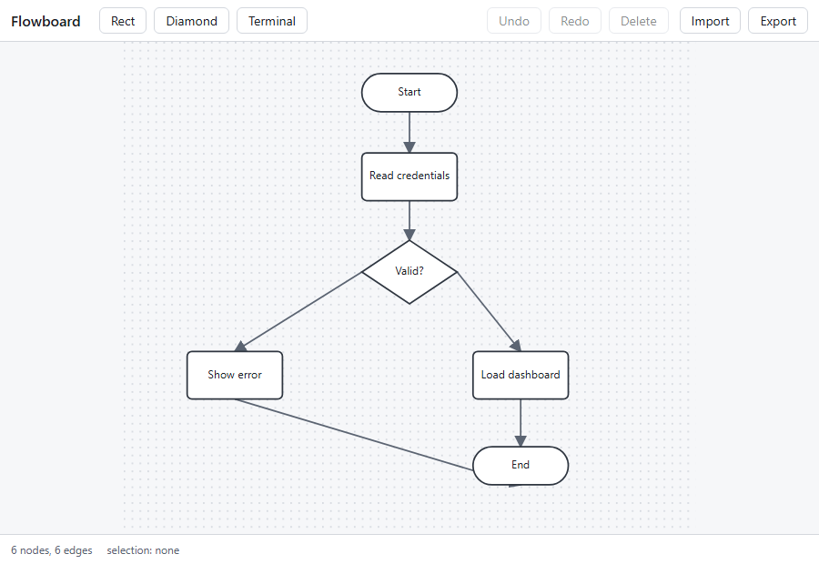

# Flowboard

[](https://github.com/Hamidullah02/flowboard/actions/workflows/ci.yml)

A React + TypeScript SVG flowchart editor, built as a portfolio project to prove
frontend and interactive-graphics skill.



> **Status: the editor works.** The toolchain, the UI shell, the fixture, and the CI
> pipeline are in place, and the document model (`src/core/`) is implemented and
> wired into the UI. The app loads the fixture flowchart, and you can add, move,
> rename, connect, select, and delete nodes, with undo and redo.

## Why this project exists

The goal is not a product. draw.io, Excalidraw, and React Flow already do this
better. The goal is a public repo that proves:

- React + TypeScript (strict, zero `any` in `src/core/`) competence
- Real geometry work (SVG coordinate transforms, port maths, hit testing)
- Reducer-based state management with working undo/redo
- Objective verification: 159 unit and component tests, 18 e2e tests across
  desktop and mobile, coverage gated at 90%

## Getting started

```bash
npm install
npm run dev      # http://localhost:5173
```

Three commands, that is the whole setup.

## Scripts

| Script                | What it does                                         |
| --------------------- | ---------------------------------------------------- |
| `npm run dev`         | Vite dev server                                      |
| `npm run build`       | Typecheck (`tsc -b`) then production build           |
| `npm run preview`     | Serve the production build locally                   |
| `npm run lint`        | ESLint, strict type-checked rules                    |
| `npm run typecheck`   | `tsc -b --noEmit`                                    |
| `npm test`            | Vitest unit + component tests                        |
| `npm run coverage`    | Vitest with coverage, fails below 90% on `src/core/` |
| `npm run e2e`         | Playwright end-to-end tests                          |
| `npm run format`      | Prettier, write mode                                 |
| `npm run demo:record` | Re-record the demo frames in `docs/demo/`            |
| `npm run demo:build`  | Assemble `docs/demo.gif` from the frames with ffmpeg |

The two `demo:` scripts rebuild the GIF at the top of this file. They are not
part of the test suite and CI does not run them. `demo:build` needs ffmpeg on
your PATH; `demo:record` needs the Playwright browsers. The frames are
intermediate output and are not committed, only the assembled GIF is.

## Deploying

The app is a static Vite build, so it deploys to any static host.

```bash
npm run build     # emits dist/
```

`vercel.json` pins the build command and the output directory, so Vercel's
dashboard needs no further setup:

```bash
npx vercel        # first time, to link the project
npx vercel --prod # deploy
```

The same `dist/` folder works on Netlify, GitHub Pages, or any static file
server. There is no backend, no database, and no login, so there is nothing
else to configure or secure.

## Architecture

```
src/
  core/      # pure logic: no React, no DOM
  ui/        # React components
  styles/    # design tokens and app styles
fixtures/    # reference flowchart, as JSON
tests/
  unit/      # Vitest specs for core/
  component/ # Vitest + Testing Library specs for ui/
  e2e/       # Playwright specs
  recording/ # the demo recorder, run by hand, not by CI
```

The one rule that shapes the codebase: **`core/` never imports from `ui/`**.
`core/` is plain TypeScript with no React and no DOM, so every rule about the
document model can be tested as a pure function. ESLint enforces this boundary
with `no-restricted-imports`, so the rule cannot rot.

### State model

```ts
type NodeKind = 'rect' | 'diamond' | 'terminal';
type PortSide = 'top' | 'right' | 'bottom' | 'left';

interface FlowNode {
  id: string;
  kind: NodeKind;
  x: number;
  y: number;
  w: number;
  h: number;
  label: string;
}
interface FlowEdge {
  id: string;
  from: { nodeId: string; side: PortSide };
  to: { nodeId: string; side: PortSide };
}
interface Doc {
  version: 1;
  nodes: FlowNode[];
  edges: FlowEdge[];
}
interface State {
  doc: Doc;
  selection: { nodeIds: string[]; edgeIds: string[] };
  past: Doc[];
  future: Doc[];
}
```

The reducer is a pure function: `(state, action) => state`. No React, no DOM, no
randomness. Positions are stored snapped to a 10px grid. History is
snapshot-based (`past` / `future` hold whole `Doc` objects, capped at 100) and
`SELECT` never creates a history entry.

### How the editor works

| Action                       | What happens                                                                                                                        |
| ---------------------------- | ----------------------------------------------------------------------------------------------------------------------------------- |
| Drag a node                  | It follows the pointer, snapped to the 10px grid; the edges follow it. Releasing commits one undo step.                             |
| Hover a node                 | Its four ports appear. Drag from a port to another node to connect. A ghost line follows the pointer and a valid target highlights. |
| Double-click a node          | Its label becomes editable. Enter confirms, Escape cancels.                                                                         |
| Tab to a node                | The node is focused and selected, so the next key acts on it.                                                                       |
| Enter on a focused node      | Starts editing the label.                                                                                                           |
| Delete / Backspace           | Deletes the selection. A node takes its edges with it.                                                                              |
| Ctrl/Cmd+Z, Ctrl/Cmd+Shift+Z | Undo and redo.                                                                                                                      |

The drag preview lives in component state, not in the reducer. The reducer is
only told the final position, once, on pointer up — that is what keeps one drag
equal to one undo step.

### Accessibility

The editor is fully operable with the keyboard, and the checks are automated
rather than left to a manual pass.

- **Every node is focusable and has an accessible name.** A node is announced
  as its kind plus its label (`terminal: Start`), and an unlabelled node is
  announced as `unlabelled` rather than as an empty string.
- **Focusing a node selects it.** There is no separate "select" step, so
  Tab → Enter → Delete is a complete edit without touching the mouse.
- **The focus ring is drawn as a stroke,** because `box-shadow` does nothing
  on an SVG element. The e2e test asserts the computed stroke in a real
  browser, because a jsdom test cannot prove the ring renders.
- **Selection is never shown by colour alone.** A selected node gets a thicker
  stroke _and_ a dashed one, so the state survives a greyscale print.
- **Contrast is measured, not assumed.** `tests/unit/contrast.test.ts` reads
  the real stylesheet and checks every text pair against 4.5:1 and every
  meaningful graphic — node outlines, edges, ports, the focus ring — against
  3:1, in both the light and the dark theme. Change a colour that fails and
  the build stops.
- **The status bar is a live region,** so the node count and the current
  selection are announced when they change. The announcement is polite, so it
  waits for a pause rather than interrupting.
- **`prefers-reduced-motion` is respected,** and the theme follows
  `prefers-color-scheme`.

### Dark mode and mobile

The dark theme is not a second set of stylesheets. The tokens in
`src/styles/tokens.css` are redefined once under
`@media (prefers-color-scheme: dark)`, and every colour in the app is a
variable. That is why the contrast test can check both themes without
duplicating the palette: it reads the same file twice.

On a phone (720px and below):

- **The toolbar moves to the bottom.** The canvas keeps the full width and
  the thumb reaches the controls without covering the drawing.
- **The canvas pans instead of shrinking the document.** Scaling a 720px
  viewBox down to a 393px phone made the nodes too small to grab and the
  ports too small to hit, so the document keeps its natural size and the
  canvas scrolls.
- **A node is dragged, not scrolled.** `touch-action: none` on a node keeps
  the pointer for the drag, while the canvas around it still pans with a
  swipe.
- **The buttons are bigger,** because a finger needs a bigger target than a
  mouse does.

A second Playwright project runs the whole suite on a Pixel 5, so all of
this is verified on every commit rather than by hand.

### Decisions worth stating

A few rules are not obvious from the code alone, so they are written down here.

- **History lives inside `src/core/reducer.ts`, not in its own `history.ts`.**
  The rules are four sentences and three branches. A separate file would
  re-export knowledge the reducer already has and make "what counts as a
  history entry" something you have to look in two places to answer.
- **`past` holds the document _before_ the change.** After editing `D0` into
  `D1`, `past` is `[D0]`, so undo returns to `D0`. Pushing the document after
  the change would make undo a no-op.
- **`IMPORT` pushes the old document onto `past`,** so an import can be undone
  like any other edit. The import is validated first: an invalid file changes
  nothing and shows an inline error.
- **A move that does not move the node is not a change,** so it costs no undo
  step. The same goes for a rejected edge (self-loop or duplicate): the state
  is returned unchanged, by reference, and no history entry is created.
- **The default id generator derives ids from the document** instead of
  keeping a counter. React's StrictMode calls a reducer twice in development,
  and a counter would burn two ids per change.
- **`clientToSvg` lives in `src/ui/pointer.ts`, not in `src/core/geometry.ts`.**
  It reads the SVG screen CTM, so it touches the DOM. A DOM-free `core/` is the
  stronger rule.
- **The focus ring is a stroke, not a `box-shadow`.** `box-shadow` does not
  render on an SVG element, so the global `:focus-visible` rule silently does
  nothing for a node. A CSS rule beats an SVG presentation attribute, so the
  ring is styled from the stylesheet instead of from the component's props.
- **The contrast test reads the stylesheet, not a copy of the tokens.** A
  duplicated palette in the test file drifts from the real one, and the test
  would keep passing while the app failed. Vitest stubs CSS imports by
  default, so `css: true` is set in `vitest.config.ts` to make the `?raw`
  import return the real file.
- **The flexible grid row is the canvas on every screen size.** On a phone the
  rows are reordered, and if the `1fr` stayed on the status bar it would
  absorb all the leftover height and sit as a tall empty band above the
  toolbar. The canvas is the only thing that should grow.

## Contributing

This project follows a written workflow:

- One logical change per commit, `type: short summary`.
- Tests before behaviour.
- `npm run lint && npm run typecheck && npm test` must pass before a commit.

### Task packages

The [`tasks/`](tasks/) folder holds two self-contained bug reports, each one
a task a contributor could pick up without reading the codebase first. Every
success criterion is a test, not an opinion, and each task ships with the
commit it starts from and a reference solution.

Both tasks were found in this codebase and verified by running the grading
tests before and after the fix:

| Task                                                                                | Failing on the starting commit | Passing with the fix |
| ----------------------------------------------------------------------------------- | ------------------------------ | -------------------- |
| [`task-01-diamond-hit-test`](tasks/task-01-diamond-hit-test/)                       | 2 of 8                         | 8 of 8               |
| [`task-02-import-validator-invariants`](tasks/task-02-import-validator-invariants/) | 8 of 11                        | 11 of 11             |

See [`tasks/README.md`](tasks/README.md) for the three steps to run one.

## License

MIT

# flowboard
